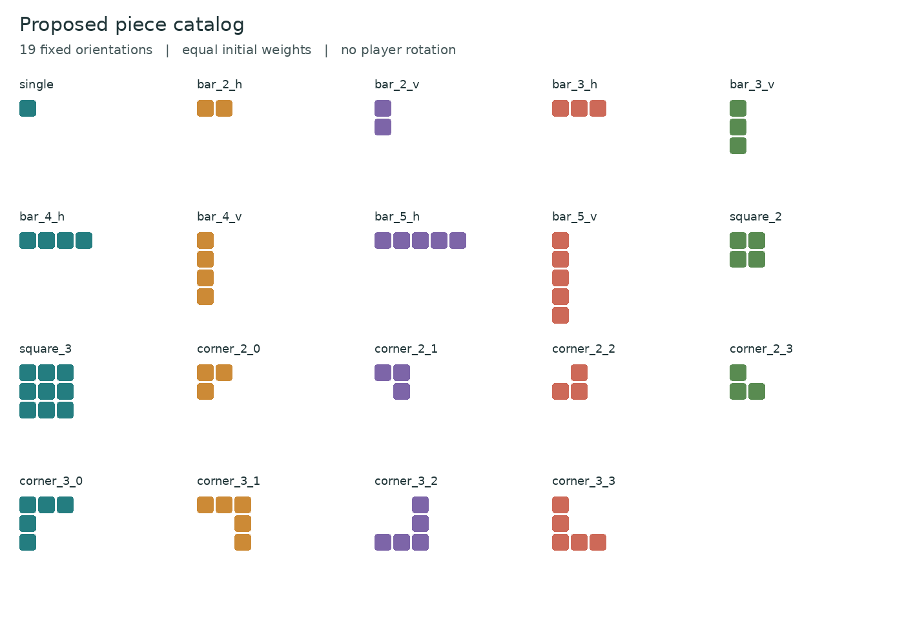
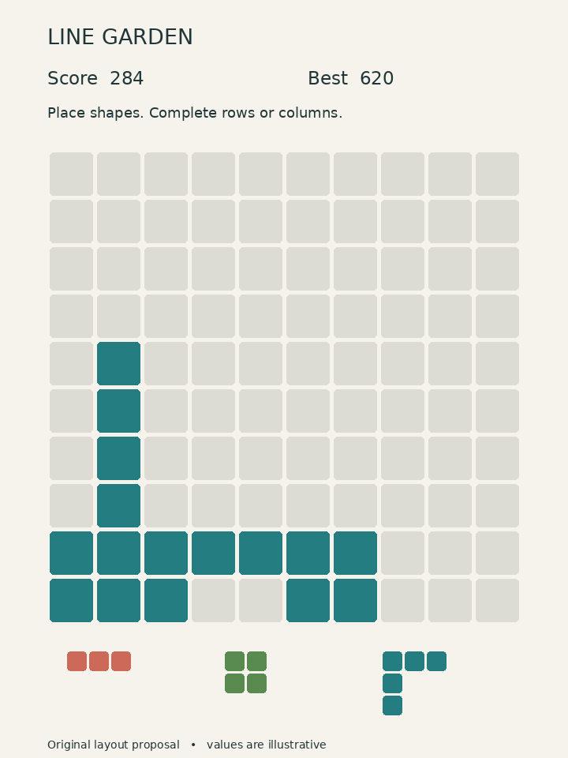

# 1010 Inspired Puzzle Game Design Document

Technical and artistic analysis with an agent implementation roadmap

Prepared for Amit | 29 October 2026 | Planning version 1.1

Working project name: Line Garden. Reference game: Gram Games’ 1010!, classic endless mode. Delivery target: a browser game rendered with WebGL2, built with TypeScript and PixiJS. This document defines the rules, presentation, architecture, configuration and staged work needed to build an original game with the same central puzzle loop.

## 1 Purpose and design decision

Build a responsive, readable block-placement puzzle that rewards spatial planning. The player places fixed shapes on a 10 by 10 board, clears completed rows and columns, and tries to beat a personal best before no available shape fits. The result should be easy to launch and easy to modify through small modules and versioned JSON content.

Use TypeScript with strict type checking, PixiJS for WebGL rendering, Vite for building static browser assets, Vitest for rule tests and Playwright for browser integration tests. Use HTML and CSS for menus, dialogs and accessible controls. The game is still a dedicated small runtime, with pure puzzle rules separated from input, rendering, audio and persistence.

WebGL is the browser graphics backend, not the language used to implement the rules. JavaScript compiled from TypeScript runs the puzzle. A Python desktop program does not become this browser build through an export setting. Since only planning artifacts exist, this revision adopts one browser production implementation rather than budgeting for two independently maintained rule engines. A future desktop wrapper can reuse the web application as a separate delivery task.

The release is a static dist directory hosted over HTTPS, plus source, a locked dependency set and a deployment guide. It requires no game server, user account or installed runtime. Normal hosting serves HTML, JavaScript, CSS, JSON, fonts and optional audio. Initial loading needs a network connection; offline relaunch and installation through a service worker are optional later work. The delivered archive is a specification, not a playable build.

## 2 Reference analysis and evidence boundaries

Gram Games describes 1010! as an endless puzzle with random blocks and completed horizontal or vertical line removal, without time limits or escalating speed [S1]. The publisher’s store description specifies a 10 by 10 board and explicitly excludes color matching [S2]. Official support confirms placing pieces into the grid and clearing complete lines [S4].

A contemporary 2015 account describes three shapes below the board and a fresh set after all three are placed [S5]. The official promotional screenshot shows a sparse pale board, colorful square tiles and the score above the play area [S3]. These establish the reference’s broad mechanics and visual hierarchy; they do not establish its source code or every historical build’s behavior.

The exact original score formula, full historical shape catalog, selection weights, fairness adjustments, animation durations and save format remain unverified. All numerical settings and algorithms below are explicit decisions for this implementation. They must not be reported as reverse-engineered original values. No binary has been decompiled and no original game session has been measured for this document.

| Aspect | Evidence and confidence | Specification decision |
|---|---|---|
| Board and clears | Official 10 by 10 grid and row or column clears [S1 S2 S4] | Preserve the central rule |
| Tray cycle | Three pieces and refill after all three in 2015 account [S5] | Three selectable slots; refill only when empty |
| Time and colors | No time pressure [S1]; colors do not match [S2] | No timer, gravity or color-dependent scoring |
| Losing condition | Space exhaustion described by secondary source [S5] | End only if none of the remaining pieces has any legal placement |
| Rotation and shape inventory | Exhaustive official contract not established | Fixed orientations; proposed 19-entry catalog |
| Score and generator | Exact original formulas not established | Placed cells plus 10 per completed line; equal-weight independent draws |
| Presentation | Official screenshot [S3] | Original palette and layout with comparable clarity |

Scope refers to the classic endless experience. Adventure modes, similarly named browser games, 1010! Color and 1010! World are not rule authorities for this project. Do not silently import bombs, streak rewards, paid rotations or matching 3 by 3 regions from adjacent games.

## 3 Product scope and player experience

The first release includes a main menu, new game, continue, settings, instructions, credits, the board and tray, current score, personal best, pause, restart confirmation and a game-over result. Mouse and touch dragging are supported. Tap or click selection and keyboard placement provide precise alternatives. Browser-local save and resume are included because an untimed run can span sessions.

The player sees all three available shapes, considers how they fit together, places one, receives immediate feedback, then plans against the changed board. Clearing a line recovers space; filling awkward isolated gaps creates pressure. There is no victory screen in endless mode. The desired feeling is calm concentration followed by a brief, readable reward when a clear succeeds.

Difficulty emerges from board geometry and the sequence of pieces. It must not rise secretly with elapsed time or score. The first deal uses the same generator as later deals; every catalog piece fits on an empty board. A fresh deal on a crowded board may have no legal move. This is allowed, visible and testable under the proposed random policy.

Release exclusions are online leaderboards, accounts, monetization, native mobile app stores, multiplayer, daily challenges, rotation, undo, rerolls, boosters, levels and avatars. The former platformer’s four people-based characters and per-character music do not apply to this puzzle. Audio is an optional global playlist, initially empty; final music and effects can be supplied later without blocking the game.

## 4 Board pieces and placement rules

### 4 1 Board representation

Use integer grid coordinates with x increasing right and y increasing down. The top-left cell is (0,0); the bottom-right is (9,9). A cell is empty or stores a visual tile key. Occupancy alone determines placement and clearing. A shape is an immutable ID and a set of unique local integer coordinates. Its bounding box starts at min x = 0 and min y = 0; the cell at (0,0) may be absent.

The release board is 10 by 10. The engine contract supports rectangular boards from 5 to 16 cells per dimension and trays from 1 to 5 slots, exercised during customization testing. Reject catalog shapes that cannot fit in an empty configured board. Alternate dimensions or tray sizes create distinct rulesets and separate personal best records.

### 4 2 Proposed catalog

Use the 19 fixed orientations in the figure and pieces.example.json. The catalog contains one single cell, horizontal and vertical bars of lengths two through five, filled 2 by 2 and 3 by 3 squares, four three-cell corners inside a 2 by 2 box, and four five-cell corners with arms of length three inside a 3 by 3 box. Each initial weight is one. This catalog is a concrete implementation baseline, not an exhaustive verified inventory from 1010!.

Each orientation is a separate stable ID; rotation is unavailable in play. Adding or removing a shape means editing the catalog and starting a new run. Do not auto-generate additional orientations at runtime. Shape validation rejects duplicate IDs, repeated cells, empty shapes, disconnected cells, negative or non-integer coordinates, non-finite numbers and unsafe integers and missing color mappings. Weights must be positive integers.

### 4 3 Legal placement

A candidate is legal only if every shape cell translated by its anchor lies within the board and is empty. Do not clamp an out-of-bounds shape into the board. The entire placement succeeds or none of it does. Preview and commit call the same placement validator; there is no second approximation in the renderer.

Invalid placement leaves the board, tray, score, random generator and save revision unchanged. A valid placement consumes only the selected slot. Other slots keep their identity and position. A piece can temporarily be unplaceable while another piece remains playable; do not end the run or replace the blocked piece early.

## 5 Turn resolution scoring and random generation

### 5 1 Atomic move transaction

For each PlacePiece command, validate session ID, expected revision, live slot instance ID and anchor. Apply these steps once: copy the current state; place all cells; collect every completed row and column on that same board; form the union of their cells; clear that union simultaneously; add the score delta; consume the slot; draw a new tray only if every slot is empty; search for any legal move among the resulting live slots; publish one committed state and one MoveResult.

Cells outside the cleared union retain their exact positions. There is no gravity, falling fill or cascade. A row and a column completed by one move both count as lines even though their shared cell is removed once. Scan all rows and columns before changing any of them so that clearing one cannot hide the other.

The returned result contains move ID, placed coordinates, completed row indices, completed column indices, unique cleared coordinates, score delta, consumed slot ID, newly dealt instances and final status. The state revision increases once per accepted move. Duplicate or stale commands return a rejection with no effects, score, random draws or writes. New sessions get new IDs so delayed input from a previous run cannot apply to a restarted game.

### 5 2 Proposed score policy

Let P be the number of placed cells and L the number of completed rows plus completed columns. The initial rule is score delta = P + 10 × L. There is no extra multi-line multiplier, consecutive-turn streak, time bonus or score for merely previewing a placement. This explicit baseline keeps the first release understandable; it is not claimed to match an undocumented original scoring formula.

| Move | Placed cells | Completed lines | Score delta |
|---|---|---|---|
| Place a four-cell shape without a clear | 4 | 0 | 4 |
| Place a single cell to finish one row | 1 | 1 | 11 |
| Place a single cell to finish one row and one column | 1 | 2 | 21 |
| Place a 2 by 2 square to finish two rows and two columns | 4 | 4 | 44 |

The crossing single-cell case removes 19 distinct cells. Two rows crossing two columns remove 36 distinct cells. The score counts completed lines, not the count of unique removed cells. Keep these as regression fixtures. Update the personal best after each accepted move and separate it by the gameplay rules hash.

### 5 3 Generator and loss detection

Draw each slot independently with replacement using the configured integer weights in catalog order. Select a uniform integer in [0,total_weight), then choose its cumulative-weight interval. Duplicates in one tray are allowed. Do not guarantee solvability, reroll difficult pieces, adapt weights or use a bag without a separate approved rule change.

Inject a PieceSource interface. The production baseline uses a versioned xorshift32 generator with a nonzero unsigned 32-bit state. Seed once from browser crypto.getRandomValues in the adapter; map a zero seed to 1. A step performs x ^= x << 13, then x ^= x >>> 17, then x ^= x << 5, with state normalized to unsigned 32 bits. State 1 must produce 270369, 67634689 and 2647435461 on the first three steps. These are specified golden vectors, not measured game results.

For unbiased bounded draws, treat output minus 1 as a value in [0, 4294967294]. Let N = 4294967295 and limit = floor(N / total_weight) × total_weight. Reject values at or above limit and return value modulo total_weight. Cap the sum of weights at 2147483647. Record seed, unsigned generator state and algorithm version in saves. This is a reproducible gameplay PRNG, not a security primitive. Scripted sources drive tests; cosmetic randomness is separate. Do not use Math.random for deals or depend on browser-specific random sequences.

After clearing and any required refill, enumerate legal anchors for each remaining shape. A brute-force scan is sufficient: at the default board size, at most three times 100 anchors times nine shape cells. Stop at the first valid placement. End only when all remaining shapes fail. A blocked selected piece is not evidence of game over. Detect a completely blocked fresh tray immediately.

## 6 Interaction screens and feedback

### 6 1 Pointer and keyboard contract

Use one native Pointer Events adapter for canvas gameplay input [S8]. Do not also subscribe the same gameplay action through Pixi events, touch events and mouse events. Begin direct dragging on an occupied tray cell, record the grabbed local cell and pointer ID, and capture that pointer on the canvas. Empty padding inside an L shape cannot begin direct drag. Ignore additional pointers until the active interaction ends.

A movement threshold of 6 CSS pixels distinguishes a tap from a drag. Tapping selects a slot; after a drag, suppress the compatibility click so it cannot submit a second command. Capture pointer movement and release even outside the canvas. pointercancel, lostpointercapture, blur, a hidden document, orientation change, resize or opening a modal cancels the gesture without consuming a piece. Release capture and clear the active ID on every exit path.

Draw the grabbed cell under the mouse; for touch, lift it 36 CSS pixels above the finger so the preview remains visible. Convert that lift through the viewport scale before deriving the grid anchor. Use exactly the same offset and snapped anchor for preview and release. Do not clamp an invalid drop onto the board. On release, recompute against current coordinates and revision and run the same domain validator used by preview.

Apply touch-action: none to the interactive canvas only, leaving document controls and surrounding page usable. When the canvas owns focus, prevent browser defaults only for handled puzzle keys. Do not intercept keyboard shortcuts or scroll keys when a text field or menu owns focus. No pointer lock or fullscreen is required to play.

Provide semantic DOM slot buttons of at least 44 by 44 CSS pixels as an alternative to picking small tray cells. Each selects a slot by ID; it does not generate a drag. A board tap or click then places the shown bounding-box anchor at that cell, including when the local origin is empty. Keys 1 through the configured tray size select slots; arrows move the anchor; Enter or Space commits; Escape cancels selection before opening pause. Ignore repeat events for commit. Keep a visible anchor marker and a keyboard focus outline.

A valid preview shows all proposed cells and the completed lines it would clear. Invalid state uses an outline and symbol in addition to color. The ghost is only a view of a query; it cannot mutate score or random state. All input methods ultimately submit the same PlacePiece command.

### 6 2 Screen flow

Main menu offers New Game, Continue when a valid active save exists, Settings, How to Play, and Credits. The browser tab provides exit; the game does not attempt to close it. Starting a new game while an active run exists requires confirmation. Continue restores exactly the committed board, tray and score. The game-over screen shows score and best with Play Again and Main Menu. Returning to menu preserves an active run; restarting deliberately replaces it after confirmation.

The session has active and game_over states. Interaction has idle, selected, dragging, resolving and paused states. Gameplay commands are accepted only while active and not resolving or paused. After a legal command, the logical transaction is already complete; the resolving state temporarily locks input while animating MoveResult. Pause freezes that animation. Returning completes the same visual event once. Reloading during animation restores the latest transaction that finished saving, never a half-cleared board. Start persistence on every accepted move; do not depend on tab-close callbacks.

### 6 3 Feedback and timing

Proposed timings are 90 ms for placement settling, 180 ms for a clear fade, and 120 ms for invalid return. Use a brief scale pulse or fade, with an immediately readable score change. No particles or screen shake may obscure board cells. Reduced-motion mode removes translation and scaling while keeping a brief opacity cue or immediate resolution. A skipped animation must release the input lock through the same completion path.

Feedback is cosmetic: delta time updates presentation only. Running at 30, 60 or 144 render frames per second must produce the same board and score for an identical command sequence. On blur or document.hidden, pause presentation and audio, cancel the active pointer and stop the render ticker. Show a Resume action on return, reset the animation clock and cap its delta to 0.1 seconds. Never run gameplay on elapsed time.

## 7 Artistic direction and asset production

### 7 1 Reference interpretation

The reference screenshot uses colored blocks against a quiet pale grid, a prominent score and generous separation between board and tray [S3]. The practical lesson is readability: the player must distinguish occupied space, potential placements and remaining pieces at a glance. The visual analysis does not imply that the original assets are reusable.

Create an original flat graphic style with warm off-white background, teal emphasis and secondary amber, violet, coral and green tiles. Use rounded square cells, consistent gaps and restrained animation. Color is decorative; identical geometry always follows identical rules. Avoid mimicking the original logo, type treatment, exact palette or store artwork. The project name is a working title awaiting final selection.

### 7 2 Layout and typography

Retain a 720 by 960 logical portrait game area with default board x=60, y=190, width=600 and height=600. Cell pitch is 60 logical pixels, with a 3-pixel inset and 5-pixel radius. The tray sits below the board. This figure is a layout reference for the game canvas; production adds semantic DOM controls around it and adapts their sizing to the browser viewport.

Fit the logical canvas into its available CSS container without cropping; letterbox when needed. Use ResizeObserver for container sizing, account for safe-area insets and dynamic mobile browser chrome, and preserve square cells. At 360 by 640 CSS pixels, board cells may be smaller than menu targets: retain accurate drag previews and the separate 44-pixel slot selectors. If available height is insufficient, allow page scrolling outside the game area rather than hiding controls. Landscape is playable through the same contained portrait layout; a bespoke landscape board is optional.

Use the canvas bounding client rectangle to convert client coordinates into logical coordinates. Device pixel ratio affects only framebuffer resolution and must not be multiplied into pointer coordinates twice. Set renderer resolution to min(devicePixelRatio, 2) initially and keep CSS size distinct from the backing buffer. Retest after orientation, zoom, container or DPR changes. Derive alternate rectangular board bounds inside the same layout region; do not stretch cells.

Use original licensed fonts, served with the build, and await font readiness before measuring text. Keep menu text in HTML at a readable CSS size; proposed minimum is 16 CSS pixels for body text. Canvas score sizes begin at 24 logical pixels but must remain legible at the smallest supported view. Provide light and high-contrast themes, visible focus rings and text cues. Respect prefers-reduced-motion by default, with a saved override. Semantic menus and keyboard play are required; full board screen-reader equivalence remains outside this release.

### 7 3 Asset list and workflow

Required assets are the original app icon, bundled font and license, button icons for pause and audio, two theme configurations, and optional five event sounds plus music. Board cells and pieces should be drawn procedurally from the catalog; a sprite sheet is unnecessary. Theme edits must not change occupancy or shape geometry. Audio files remain optional until supplied or separately authored.

First validate the entire puzzle using simple rectangles. Then finalize tile spacing, type hierarchy, focus and previews on real target resolutions. Create only the small original icons needed by the menu. Record author, source and license for every external asset. Do not package publisher screenshots or logos; the reference links remain documentation only.

## 8 Technical architecture and extension boundaries

### 8 1 Domain and application structure

Use strict TypeScript, readonly data contracts and small functions or cohesive classes. Keep BoardState, ShapeDefinition, PlacePiece and MoveResult free of Pixi, DOM, IndexedDB and Web Audio types. TypeScript readonly does not enforce deep runtime immutability: clone changed rows, avoid leaking writable arrays, and optionally freeze public snapshots in development. Validate external data at runtime; static types do not validate fetched JSON.

| Layer | Responsibilities | Depends on |
|---|---|---|
| domain | Grid, placement, simultaneous clears, scoring, legal-move search | Pure TypeScript and standard language features |
| application | Session, revisions, deterministic deals, command orchestration | Domain and narrow interfaces |
| presentation | Presenter, pointer interaction state, view models, feedback timing | Application queries and commands |
| adapters | Pixi renderer, DOM controls, Pointer Events, IndexedDB, Web Audio, fetch | Browser APIs and application contracts |
| bootstrap | Content loading, validation and concrete dependency construction | All layers at startup only |

Keep PlacementRules, ClearResolver and ScorePolicy separate by responsibility without requiring an interface for every function. PieceSource, SaveRepository, AudioOutput and ContentRepository are useful replaceable boundaries. Inject them explicitly. Do not introduce a service locator, generic ECS, runtime plugin framework or React solely to implement this small game. Plain semantic HTML is enough for menus.

Use src/domain, src/application, src/presentation, src/adapters and src/bootstrap, with tests/unit, tests/browser, public/content, docs and tools. Domain tests run under Node without a browser. Browser tests exercise adapters and UI. Pin Node, package-manager and package versions; commit the lock file. The plan names responsibilities, not pre-existing files.

### 8 2 WebGL runtime and lifecycle

Create one Pixi application and explicitly select its WebGL renderer using APIs verified against the pinned stable version [S6]. Require WebGL2 for the initial production support target. Confirm the actual selected context during initialization; do not silently ship WebGPU or Canvas2D fallback and call it WebGL. If initialization fails, show a normal HTML explanation with Retry and browser-help guidance. The error screen must render without a canvas or GPU.

The main render ticker advances cosmetic effects and draws snapshots. Input handlers submit commands; the domain does not run on elapsed time. Use retained display objects for cells and tray tiles, update only changed appearance, and avoid allocating the board every frame. Reuse graphics geometry or simple textures. Set a 60 fps render target; suspend animation and rendering while hidden. There is no physics loop and no need for threads, WebAssembly or SharedArrayBuffer.

Keep one authoritative session. Compute a move using copies of state and generator state; publish only a fully valid result. Guard asynchronous content, save and audio completions with the active session or load-generation ID so late responses cannot overwrite a restart. Dispose event listeners, tickers, graphics resources and observers on teardown. Bound diagnostic histories and preserve only enough events to reproduce a problem.

A WebGL context may be lost during ordinary device operation [S12]. On loss, cancel drag, stop the ticker and show a DOM recovery overlay while preserving the last committed logical state. Allow the pinned renderer’s supported restoration path to recreate its resources, then redraw from that state and require Resume. Do not apply the last move again. If restoration does not succeed within a proposed 10 seconds, offer reload with the current save status. Test using WEBGL_lose_context when available and on real devices; renderer recovery must not be assumed from a unit test.

### 8 3 Change map

| Desired change | Primary edit | Required check |
|---|---|---|
| Add or remove a shape | Versioned piece catalog and color mapping | Validation, legal fits and new gameplay hash |
| Change board or tray size | Rule configuration | Responsive layout, input and records |
| Change scoring | Score configuration or policy | Golden fixtures and new gameplay hash |
| Change palette or timings | Theme content | Readability and unchanged gameplay hash |
| Add music | Audio manifest and hosted files | Codec support, gesture unlock and failures |
| Add undo or rotation | New command and ruleset | Save compatibility and new acceptance tasks |
| Add offline install later | Service worker and cache version policy | Upgrade, stale-content and offline tests |

Supported content edits require a content deployment, but do not require recompiling application code. New mechanics require scoped code and tests. No browser can read arbitrary files beside an executable; operator-managed hosted JSON replaces that workflow. A local end-user mod editor is optional future functionality.

## 9 Browser content persistence audio and deployment

### 9 1 Content loading and configuration

Place immutable release content under public/content/<content_version> and copy it into the static build. A small content/index.json selects a compatible versioned manifest, whose entries reference rules, pieces, theme, runtime and audio JSON. Resolve runtime URLs against the application base and then the manifest directory. Vite handles built asset paths, but dynamically constructed content URLs also need the correct base [S13]. Never assume that the app is hosted at the origin root.

At startup, fetch the index with revalidation, select one manifest, fetch and validate all required configuration, then freeze that content selection for the session. Enable New Game only after the required files and font are ready. Show loading progress, a clear error and Retry for network or schema failure. Optional missing music remains silent. No network request is necessary to place a piece once required content is in memory.

Use request cancellation or load tokens when retrying or restarting loading. A slow response from an old load must not replace the active content. Reject unknown gameplay keys, unsupported policy enums, duplicate shape IDs, invalid colors and non-integer rule values. Integer counts, revisions and scores must remain nonnegative safe JavaScript integers; detect overflow rather than rounding silently. The full validator runs in both content checks and browser startup.

Freeze the effective gameplay configuration per run. Compute SHA-256 over a documented canonical JSON encoding that includes board dimensions, tray count, ordered catalog geometry and weights, refill and clear policies, score values and generator algorithm/version. Sort object keys recursively, preserve catalog array order and normalize shape-cell order. Exclude theme colors, audio, layout and content paths. Compute asynchronously through an adapter before enabling the run; the domain receives the resulting identity, not a browser crypto dependency.

Content versions are immutable directories. Publish their files first, verify them, then change the revalidated index atomically. Keep prior releases available for rollback. A running tab keeps its selected configuration; a new load may select the updated content. A changed gameplay hash prevents direct resume of an incompatible run and offers an explicit new-game choice while retaining saved data. Cosmetic releases retain the gameplay hash and resume normally.

### 9 2 Browser saves and recovery

Use IndexedDB with one application-specific database and a versioned envelope containing active session ID, move revision, board, live slot instances, score, status, gameplay hash, generator seed and state, settings and rules-scoped best scores. Keep a last-known-good envelope as backup. IndexedDB supports transactional updates; a request succeeding is not the same as its transaction completing [S9].

Publish each valid move in memory, then queue an ordered save immediately. In one readwrite transaction, read the current envelope, verify its storageRevision, and replace current and backup together. Increment storageRevision for every envelope write, including settings and restarts; keep it separate from the gameplay move revision. Mark Saved only after transaction completion. While newer snapshots remain queued, show Saving. Do not depend on unload or beforeunload to perform asynchronous writes. A killed tab may lose pending changes, but never a partially applied move.

Two tabs must not overwrite each other silently. Compare the expected persisted storageRevision inside the same readwrite transaction as the update. On mismatch, stop the local writer, pause gameplay and offer Load latest or Return to menu. Do not merge divergent boards or auto-force a stale write. Reloading the latest envelope resets the expected storageRevision. Tests must include simultaneous moves and a restart from another tab. Optional cross-tab notifications improve responsiveness but do not replace the transactional guard.

If storage is unavailable or quota is exceeded, keep the in-memory run playable with a persistent Session only indicator and an explicit retry action. Keep only the latest pending snapshot while persistence is disabled to bound memory. Validate loaded data, preserve corrupt or unsupported records, and offer explicit backup recovery or reset. Recompute legal moves after loading and never resume a half-resolved board. Show an update/reload action when another tab blocks a database schema upgrade.

Browser-local progress is tied to the site origin and browser profile. Clearing site data, eviction, private browsing or moving to another origin may remove or hide saves [S10]. A completed database transaction is not a cloud backup or an absolute disk durability guarantee. State this briefly in Settings. Accounts, cloud synchronization and import/export are optional later features; the local score is not suitable as a trusted online leaderboard entry.

### 9 3 Browser audio

Initial audio configuration may be empty. Create or resume the AudioContext only from an explicit Play, Resume or Enable sound gesture and handle rejected resume/play requests [S11]. Loading the page must not require audible autoplay. Display a sound-enable control when browser policy leaves the context suspended; silent gameplay always remains possible.

Use an AudioOutput adapter with master, music and SFX gain controls. Stream music through a media element routed into the audio graph and decode only short effects into buffers. Start with bundled same-origin MP3 music and WAV effects, verified on the supported browser matrix. Lazy-load music after the gesture. Do not fetch or decode all long tracks at startup. The shuffled repeating playlist uses cosmetic randomness and never affects deals.

Associate playback callbacks with a generation token; detach or invalidate old ended/error handlers on replacement. Pause and tab suspension cannot be interpreted as track completion. Skip bad tracks with bounded attempts and remain silent if none can play. Pause audio when hidden and require a valid Resume gesture on return if needed. Missing assets, codec errors or unavailable audio hardware are nonfatal.

### 9 4 Static production delivery

Vite builds the application into dist for static hosting [S7]. Use HTTPS in production and a local HTTP server for development or build preview; opening index.html through file:// is not a supported launch method. Vite preview is a local verification tool, not the production server. Test both origin-root hosting and a nested path such as /line-garden/ with correct base URL configuration.

Ship a compiled release ZIP, source at a recorded commit, dependency lock, content, font and asset licenses, actual browser-test evidence, deployment instructions and rollback steps. No Python runtime, server-side game process or native executable is required. Keep scripts, fonts, JSON and audio same-origin by default. If assets later move to a CDN, explicitly test cross-origin permissions for fetch, fonts and Web Audio. Do not embed secrets in client code or public content.

Serve hashed JS/CSS and immutable versioned assets with long-lived immutable caching. Serve index.html and content/index.json with revalidation. Publish complete assets before switching the HTML/index pointers; retain the previous release so old tabs can finish loading. Verify MIME types, compression and clean missing-file responses. Do not route missing JSON or JavaScript requests to an HTML success page. Set deployment framing policy deliberately if embedding is requested; cross-origin iframe and private-mode storage are not assumed to behave like top-level browsing.

No service worker is included in version 1.1, so offline reload is not promised. An already loaded game may keep running without the network using its in-memory content, while future music downloads can fail silently. Add a PWA only through separate tasks for a versioned offline cache, update prompt, save compatibility and rollback. A future desktop wrapper is also a separate packaging task; both can reuse the pure domain.

## 10 Browser quality gates and review protocol

Core correctness remains unchanged: every shape and edge, overlap, simultaneous intersections, unchanged untouched cells, exact score deltas, consumption, refill and no-move detection. Use Vitest for rules and Playwright for integration. Golden PRNG vectors and commands must yield identical results in Node, Chromium, Firefox and WebKit. A rejected command leaves state and generator untouched.

Use occupancy_after = occupancy_before + placed_cells - unique_cleared_cells, and verify that an accepted move leaves no full line. Compare loss detection with a simple independent enumerator on small boards. Run at least 1,000 bounded seeded sequences. Generated immediate losses are permitted under the documented random policy and must not be hidden by test-only rerolls.

Test pointers on CSS-scaled canvases at DPR 1, 2 and 3 with the resolution cap, all edges, small touch targets, touch lift, a second finger, pointer cancellation and capture loss. Test keyboard navigation and page scrolling outside the game. Identical commands at 30, 60 and 144 render fps must have identical logical hashes. Validate previews visually on real touch hardware; emulation cannot prove finger occlusion or mobile browser chrome behavior.

Test tab hiding, device rotation, renderer disposal, WebGL context loss and restoration, rejected audio unlock, bad codecs, slow and failed content fetches, missing fonts, quota errors, two-tab conflicts, interrupted saves and schema upgrades blocked by another tab. Loading errors must not leave an infinite spinner. The DOM error interface must work when WebGL2 is unavailable. Restoring graphics must never reset the board or replay score events.

| Browser target | Required evidence | Release status rule |
|---|---|---|
| Chrome and Edge on Windows | Current stable at test date, mouse and keyboard, real WebGL2 | Record exact builds and GPU |
| Firefox desktop | Current stable, rendering and persistence | Record exact build and platform |
| Safari on macOS | Current stable, actual Safari run | WebKit automation alone is insufficient |
| Safari on iPhone | Real supported device, touch, orientation and audio | Record model, OS and browser build |
| Chrome on Android | Real supported device, touch and suspend/resume | Record model, OS and browser build |

Freeze concrete tested versions and minimum device assumptions in T01 and refresh the release matrix at T29. This table is a target, not a claim of universal support. WebGL2-disabled devices receive the unsupported message. Unsupported embedded in-app browsers may be directed to open the normal browser.

Proposed performance budgets are 60 fps on the recorded desktop and midrange phone, p95 active-animation frame interval at most 20 ms on a 60 Hz device after warm-up, and command processing under 8 ms at p95 excluding asynchronous storage. Initial compressed transfer should be at most 2 MB excluding optional audio. Target interactive within 3 seconds under a recorded 10 Mbps and 100 ms latency profile, measured with a cold cache. Cap render DPR at 2 and test 100 restarts for retained listeners or GPU objects. These are targets to measure, not current results.

Amit reviews placement accuracy, touch comfort, readability, difficulty and restart pace using the release candidate. Record decisions and repeat directly affected checks after changes. Hosted production verification includes root and nested URLs, refresh, content updates, cache behavior, rollback, no-account play and origin-scoped saves. Any unavailable real-device or hosted check remains NOT RUN and blocks claiming that target as verified.

## 11 Delivery phases and open inputs

| Phase | Outcome | Task range |
|---|---|---|
| A | Browser toolchain and early WebGL build | T01 to T04 |
| B | Verified puzzle rules and atomic commands | T05 to T12 |
| C | Responsive input screens and browser saves | T13 to T20 |
| D | Original visuals audio and browser recovery | T21 to T25 |
| E | Performance review and hosted release handoff | T26 to T30 |

The rule baseline, 19 shapes and original art direction carry forward from version 1.0. TypeScript replaces the planned Python runtime, and the 30 task IDs remain stable with web-specific scope and acceptance changes. No implemented code or save migration is claimed; no game code existed in the prior pack. The generator algorithm and persistence contract are new proposed browser decisions.

The final title, optional audio, hosting destination and actual test devices remain to be selected. Produce a provider-neutral static artifact before hosting is chosen. If deployment access is unavailable, deliver the artifact and precise instructions while retaining hosted verification as pending. Publishing requires the user’s existing authorization or approval of the concrete release candidate; a planning request is not authorization to publish a live site.

Primary risks are drag mapping under DPR and touch lift, context recovery, browser persistence conflicts and mixing cached content versions. Each is covered by explicit tasks and acceptance checks. Do not estimate completion dates before measuring the early WebGL shell and rule prototype.

## 12 Sources and provenance

Research accessed on 29 October 2026. Official pages establish the broad reference mechanics and visual direction. The 2015 secondary source supports the historical tray cycle. The configuration, scoring baseline, catalog, architecture, browser production contracts, figures and roadmap are original implementation proposals. No screenshot is included as a production asset. Source access dates are not the release dates of the game.

[S1] Gram Games official 1010 page. https://gram.gs/game-detail-1010.html Primary description: endless random block placement, horizontal and vertical line clears, no timer or speed escalation.

[S2] 1010 Block Puzzle Game App Store listing. https://apps.apple.com/us/app/1010-block-puzzle-game/id911793120 Publisher listing: 10 by 10 board, no color matching, themes. The live app evolves; this specification targets classic endless play.

[S3] Zynga official 1010 product page and screenshot. https://www.zynga.com/games/1010 Primary visual reference. Screenshot shows a pale board, colored square tiles, score above and a three-piece tray below.

[S4] Zynga support How do I play the game. https://zyngasupport.helpshift.com/hc/en/87-1010/faq/13689-how-do-i-play-the-game/?l=en Primary support confirms fitting pieces and clearing completed horizontal or vertical lines.

[S5] YALSA App of the Week 1010 published 15 July 2015. https://yalsa.ala.org/blog/2015/07/15/app-of-the-week-1010/ Contemporary secondary account: 10 by 10 board, three shapes, replacement after all three are used, play until space runs out.

[S6] PixiJS application and renderer documentation. https://pixijs.com/8.x/guides/components/application Renderer initialization, renderer preference, resolution and sizing. Verify exact APIs against the pinned stable release; this plan requires WebGL2.

[S7] Vite static deployment guide. https://vite.dev/guide/static-deploy Static production build and deployment base path. The preview server is for local inspection, not production hosting.

[S8] MDN Pointer events. https://developer.mozilla.org/en-US/docs/Web/API/Pointer_events Unified pointer handling, capture, cancellation and touch-action behavior.

[S9] MDN Using IndexedDB. https://developer.mozilla.org/en-US/docs/Web/API/IndexedDB_API/Using_IndexedDB Transactional browser persistence, completion events and the limits of saving during unload.

[S10] MDN Storage quotas and eviction criteria. https://developer.mozilla.org/en-US/docs/Web/API/Storage_API/Storage_quotas_and_eviction_criteria Storage is scoped to the origin and can be evicted or cleared; private sessions have additional limitations.

[S11] MDN Web Audio best practices. https://developer.mozilla.org/en-US/docs/Web/API/Web_Audio_API/Best_practices User-gesture requirements and suspended audio contexts.

[S12] MDN WebGL context loss. https://developer.mozilla.org/en-US/docs/Web/API/WebGLRenderingContext/isContextLost Graphics contexts can be lost during normal browser or GPU operation.

[S13] Vite static asset handling and build paths. https://vite.dev/guide/assets Public files can retain stable names. Runtime content URL construction must also respect the deployment base.
